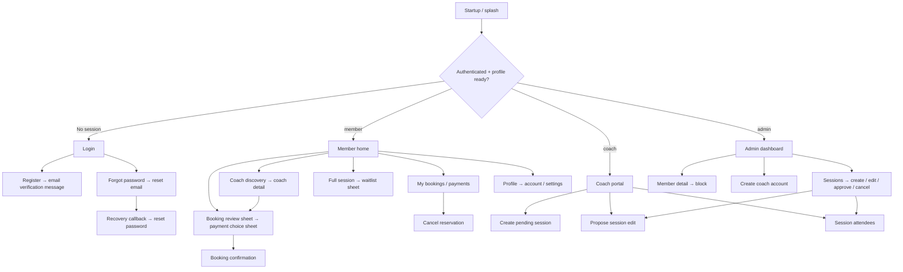

# Fléx Pilates & Padel — audit and design strategy

Date: 5 November 2026. Repository reviewed: `Pilate.Padel.BookingApp`, HEAD `2a82b92`.

Status: Phases 1–2, for review. No application code, dependencies, configuration, database, or routes changed. The reference supplied during the audit is included in the companion [visual direction board](visual-direction.html). All files in this review folder are design documents outside the application repository.

### User decisions — latest scope

- Keep payment improvements as the final work package. Preserve all existing payment paths and behavior while earlier phases proceed; do not add a gateway or change payment rules now.
- Preserve the original light mint, sage, white and green-charcoal palette. Add complementary tones only where they fit the existing identity or improve contrast. The earlier dark/lime-first direction is superseded.
- Use free, open-source building blocks for messaging, notifications and confirmations. Distinguish free software from hosted-service quotas and infrastructure costs; do not silently introduce a paid provider or describe FCM as an open-source service.
- Use [Rive Marketplace](https://rive.app/marketplace/) for selected animation assets. Keep the original palette, verify asset-specific reuse and free download/export conditions, and follow the [Rive motion plan](RIVE-MOTION-PLAN.md).
- Keep future integration choices adaptable. This updates the review proposal; it does not install a service, deploy infrastructure, send messages, or implement unspecified future features.

The updated [integration plan](COMMUNICATIONS-PLAN.md) records the proposed building blocks and delivery limits.

## 1. Assessment and evidence limits

The app has a useful foundation: a compact layered architecture, real Supabase flows, role routing, shared components, a consistent wellness palette, and recent improvements to member discovery and profiles. Preserve these investments. The redesign should improve information quality and booking confidence alongside composition, imagery, and motion.

The supplied reference informs photographic composition, compact schedules, selection clarity and the rounded bottom dock. Following the user's subsequent palette decision, translate these principles into the original light mint/sage identity rather than adopting the reference's black/lime palette. Use warm Pilates imagery and more energetic Padel compositions within one light system.

This is a source-level audit, not a live-device or deployed-database audit. Reviewed all 64 Dart source files, all 23 screen implementations, 21 shared widget files, the manifest/lockfile, six SQL migrations, three Edge Functions, platform configuration, tests, and relevant Git history. Applied the [local premium UI skill](../SKILLS/pilate-padel-premium-ui-skill.md). No production account or database was accessed. Screenshots of the existing running Flutter app were unavailable.

Baseline verification:

| Check | Result |
|---|---|
| Repository status before review | Clean |
| `flutter analyze` | Could not execute: `flutter: command not found` |
| `flutter test` | Could not execute: `flutter: command not found` |
| Dart / Flutter SDK discovery | Neither on PATH; no Flutter found in searched common installation paths |
| Local `.env` asset | Absent; startup currently requires it |
| Firebase platform configuration | Android `google-services.json` and iOS `GoogleService-Info.plist` absent |
| Existing automated coverage | One arithmetic sanity test; no application behavior coverage |
| Formatting/build/device screenshots | Not performed; no Dart files changed and no runnable SDK |

These are baseline limitations, not regressions caused by this review. Dependency versions below come from the existing lockfile, not a successful local dependency resolution.

Review-artifact checks: rendered and visually inspected the HTML concept board in Firefox at 1500 dp and 390 dp viewport widths; saved [desktop](visual-direction.png) and [mobile](visual-direction-mobile.png) previews. Checked local asset/document links, bundled both font licenses, confirmed inventory coverage for all 23 screen files, and rechecked that the application Git tree is clean. These checks validate the presentation documents only, not the Flutter UI or backend.

## 2. Architecture and product map

```text
lib/
  main.dart                       startup + seven global providers + MaterialApp.router
  app/                            theme.dart, router.dart
  controllers/                    seven ChangeNotifiers
  models/                         five typed data models
  services/                       five backend/support services
  views/
    screens/auth/                 5 screens
    screens/member/               7 screens
    screens/coach/                2 screens
    screens/admin/                6 screens
    screens/common/               3 screens
    widgets/                      21 shared widget files
supabase/
  migrations/                     6 SQL migrations
  functions/                      3 Edge Functions
  seed.sql                        empty
test/widget_test.dart             arithmetic sanity check
android/, ios/, web/, linux/, macos/   target scaffolding
```

### Startup and state

`main.dart` loads `.env`, initializes Supabase, attempts Firebase initialization, requests notification permission, starts authentication listening, constructs GoRouter, and installs providers. Firebase errors are swallowed so local operation can proceed without its configuration; missing `.env` is not handled the same way.

| Controller | Responsibility | Preserve / watch |
|---|---|---|
| `AuthController` | Sign in, registration, profile creation/recovery, password recovery/change, account names, admin coach creation | Auth listener drives router refresh; role/profile loading is sensitive |
| `SessionController` | Daily/all sessions, create/update/cancel/approve, coach edit requests | One shared sessions list and loading/error state serve several views |
| `BookingController` | Member reservations, cancellation, attendee queries, payment update, booking realtime | Member/session data share state; submission loading is global |
| `WaitlistController` | Join/leave, queue preview, fetch entries, session-change subscription | Queue authority belongs to database triggers; notification invocation incomplete |
| `CoachController` | Coach schedule, trainees, fill rates and metrics | Aggregates computed in Dart; trainee query omits the status it later filters |
| `AdminController` | Dashboard, users/coaches, block members, pending payment validation | Some mutations refresh data without notifying consumers afterward |
| `SettingsController` | Notification preference persistence | Persisted preferences are not proof of notification delivery |

Models: `Profile`, `SessionModel`, `Booking`, `BookingDetail`, `WaitlistEntry`. `SessionModel` has display names but no activity category, court, imagery, or address fields. Main session queries do not join coach/studio names; their fallback values are often used. `Booking` and `WaitlistEntry` hold session IDs without session display details.

Services: `SupabaseService` is the shared client; `CoachDirectoryService` fetches visible coaches and related sessions; `MemberProfileSummaryService` computes member summaries; `NotificationService` only requests Firebase permission; `SessionNotificationService` writes/reads database notifications; there is no payment gateway service.

### Authentication and navigation



GoRouter uses `AuthController` as its refresh listenable. Public paths are `/`, `/login`, `/register`, `/forgot-password`, `/reset-password`. Authenticated entry redirects by role; `/member`, `/coach`, and `/admin` prefixes are protected against the other roles. Settings/account are shared authenticated routes. `/sessions/:id/attendees` lacks an explicit staff-role guard; database RLS remains relevant.

The router has 24 declarations for 23 distinct screens. `/member/booking/new` is an alias for Member Home, not a separate booking screen. There is no ShellRoute or tab-state preservation mechanism. Member tab definitions are copied across four screens; `go`/`push`, extra-based return paths, and imperative modal navigation are mixed.

Auth edge cases to verify before transitions are customized: the guard allows navigation while a signed-in profile is unresolved; Splash has a separate timed redirect with no member branch; profile fetch failures have no explicit recovery UI; auth subscriptions are not retained/disposed; the password-recovery stream is not closed. These are source-level race/lifecycle risks, not observed device failures.

### Supabase contracts

Eight tables: `profiles`, `studios`, `sessions`, `bookings`, `waitlists`, `notifications`, `session_edit_requests`, `user_settings`. RLS is enabled on each in the checked-in migrations.

Important contracts to retain:

- Profiles connect to Supabase Auth with roles `member`, `coach`, `admin`; member tiers are standard/silver/gold/platinum.
- Sessions belong to a coach and optional studio; statuses are pending/scheduled/cancelled/completed; levels are all/beginner/intermediate/advanced.
- Bookings distinguish confirmed/cancelled/attended from pending/paid/rejected payment state. Methods are cash/card/mobile. Amounts use TND.
- A database trigger updates `sessions.booked_count`; a capacity constraint rejects over-capacity updates. Preserve server authority and handle a spot disappearing during checkout.
- Waitlists have a unique member/session constraint and position assignment/resequencing triggers. Client position previews cannot represent a guaranteed place.
- Coach-created sessions need admin approval; coach changes use `session_edit_requests` and a separate admin approval process.
- `create-coach-account` verifies the caller's admin profile and creates the account server-side. Preserve the one-time credential display without logging it.
- `auth-redirect` and `auth-confirm` are HTML handoff surfaces, not Flutter screens. Preserve callback contracts and `flexpilates://` deep links.

No dedicated court, court availability, venue address, activity discriminator, reviews, messaging, rescheduling transaction, or payment-provider contract appears in the repository. Sessions can have arbitrary sport-related titles, but that does not establish separate Pilates/Padel filtering or court inventory.

## 3. Complete screen inventory

Paths below refer to `lib/views/screens/`. Priorities: P0 = protects booking correctness; P1 = primary member experience; P2 = staff experience. Each screen inherits the responsive/accessibility/state requirements in section 8.

### Authentication — 5 screens

| Screen / route | Goal, entry and exit | Data / actions | Current gaps and proposed treatment |
|---|---|---|---|
| `auth/splash_screen.dart` — `/` | App entry → login or role home; detect recovery links | Auth/profile; timed handoff | P0: reconcile member/profile readiness before styling. Short forest brand reveal; no artificial wait once ready; recoverable startup state |
| `auth/login_screen.dart` — `/login` | Sign in → role home; links to register/forgot password | Auth sign-in, loading, toast errors | P1: non-scrolling Column risks keyboard/short-screen overflow; password is trimmed; sparse validation and autofill. Branded composition, persistent labels, visible-password control, inline recovery |
| `auth/register_screen.dart` — `/register` | Create member account → login/verification message | Auth signup; names/email/phone/password | P1: largely hint-only inputs; mainly checks password equality. Group related fields, field validation, clear verification handoff |
| `auth/forgot_password_screen.dart` — `/forgot-password` | Login → email reset request → login | Auth reset email; inline errors and loading | P1: keep scrolling and feedback; provide persistent sent state with resend/back action |
| `auth/reset_password_screen.dart` — `/reset-password` | Recovery link or account → change password → login target | Auth password update, mismatch/length checks | P0/P1: validate expired recovery and authenticated-change return paths; preserve form; clear success and role-aware navigation |

### Member — 7 screens

| Screen / route | Goal, entry and exit | Data / actions | Current gaps and proposed treatment |
|---|---|---|---|
| `member/member_home_screen.dart` — `/member/home` | Role entry/tab → choose date, reserve, join waitlist; other tabs | Auth + daily sessions + bookings + realtime; two booking sheets | P0/P1: upcoming data joined only against the selected day; no real future filter; full-page reload on date changes; no session error UI. Put reliable next booking first, then schedule browsing with stable date strip |
| `member/member_explore_screen.dart` — `/member/explore` | Member tab → search coaches → coach detail | Coach directory service; client name/speciality search | P1: hint promises session search but only coaches are searched; no retry; avatars ignored. Preserve recent search/directory work, improve profiles and search accuracy |
| `member/member_coach_detail_screen.dart` — `/member/coaches/:id` | Explore → coach information / session booking → Explore or success | Coach details, related sessions, BookingController | P0/P1: booking enabled by future start alone, without full/already-booked checks; duplicated checkout; raw error text/no retry. Unify eligibility and sheet presentation; use genuine avatar if present |
| `member/member_bookings_screen.dart` — `/member/bookings` | Member tab → reservations / payment history; cancellation stays here | BookingController | P0/P1: shortened IDs, cancelled marked “Done”, past confirmed considered upcoming, immediate unguarded cancellation, no loading/error/empty handling. Show session details with upcoming/history/cancelled filters; retain payments as a secondary view |
| `member/member_waitlist_screen.dart` — `/member/waitlists` | Route exists; back target profile; no visible entry found | WaitlistController; leave queue | P0/P1: discoverability missing; IDs instead of names; no loading/error distinctions; no leave confirmation. Add entry from bookings/profile with count, position and session summary |
| `member/member_profile_screen.dart` — `/member/profile` | Member tab → account/settings/sign out | Auth + member summary FutureBuilder | P1: future created in build; errors collapse into zeros; rating is tier-derived. Preserve genuine summaries and tier; replace misleading rating presentation and add waitlist access |
| `member/payment_success_screen.dart` — `/member/payment-success` | Successful booking → home | Route extras + shared SuccessScreen | P0/P1: generic date/coach/studio placeholders; cash still says “Total paid”; route can display default receipt data. Show confirmed reservation details and true amount due/paid; offer bookings/home |

### Coach — 2 screens

| Screen / route | Goal, entry and exit | Data / actions | Current gaps and proposed treatment |
|---|---|---|---|
| `coach/coach_home_screen.dart` — `/coach/home` | Role entry → sessions/attendees/create; settings/sign out | Coach metrics/schedule; SessionController edit request dialog | P2: long mixed-purpose page; sessions lack date grouping; loading/errors not surfaced; edit dialog is long and controllers aren't disposed; stats include unsuitable statuses. Schedule-first layout with dates, compact metrics, clear pending/edit-request feedback |
| `coach/new_session_screen.dart` — `/coach/sessions/new` | Coach home → pending session request → coach home | Studios + Auth + SessionController; title/date/time/capacity/level/price | P2: manual date/time parsing, defaulted invalid numbers, limited studio failure recovery. Reuse native date/time pickers and grouped session form; preserve pending approval semantics |

### Administrator — 6 screens

| Screen / route | Goal, entry and exit | Data / actions | Current gaps and proposed treatment |
|---|---|---|---|
| `admin/admin_home_screen.dart` — `/admin/home` | Role entry → payment review, member detail, add coach, sessions | AdminController; approve/reject payments, member search | P2: long dashboard, inline raw diagnostics, inaccurate period labels, coach Edit no-op, blocked members excluded from list. Action queue first, defined metric periods, genuine errors/retry, structured member/coach sections |
| `admin/admin_sessions_screen.dart` — `/admin/sessions` | Admin home → create/edit/attendees; approve changes and sessions | SessionController sessions/edit requests | P2: “THIS WEEK” is all sessions; missing date hierarchy; no operation-specific loading/errors. Date/status filters and separate approval section; preserve actions and confirmations |
| `admin/admin_new_session_screen.dart` — `/admin/sessions/new` | Sessions → publish scheduled session → sessions | Coach/studio queries + SessionController | P2: largely duplicates coach form; missing mounted check in coach-loading finally; manual date/time fields. Share visual/form building blocks while keeping admin scheduling behavior |
| `admin/edit_session_screen.dart` — `/admin/sessions/:id/edit` | Session list → change title/level/price → sessions | Reads existing SessionController list; updates session | P0/P2: deep link can open blank form; no local record fetch, guarded save, field validation or submission error UI; schedule/capacity aren't editable here. Load by ID and preserve actual editable scope |
| `admin/add_coach_screen.dart` — `/admin/coaches/new` | Admin dashboard → create coach → dashboard | AuthController → Edge Function; one-time password dialog | P2: basic required checks, no reliable dashboard refresh after return; direct-link pop needs verification. Group identity/contact/speciality; secure credential handoff and clear success |
| `admin/member_detail_screen.dart` — `/admin/users/:id` | Dashboard → inspect member/block → dashboard | AdminController cached user + member summary | P0/P2: depends on loaded parent data; email field absent from profile schema; Active badge unconditional; Message no-op; no unblock UI. Independent record loading, accurate status, confirmed block action, explicit unsupported messaging state |

### Shared authenticated screens — 3 screens

| Screen / route | Goal, entry and exit | Data / actions | Current gaps and proposed treatment |
|---|---|---|---|
| `common/settings_screen.dart` — `/settings` | Profile or coach home → preferences/account/sign out → supplied return path | SettingsController notification preference reads/upserts | P1/P2: early defaults during load, errors via toast; account return always member profile. Persisted preferences need honest delivery wording; keep role-aware return paths |
| `common/manage_account_screen.dart` — `/account/manage` | Profile/settings → edit names, password change → supplied fallback | AuthController profile update | P1/P2: name editing only; forms lack persistent labels; coach entry inherits member fallback. Keep fields and errors, improve focus/autofill/save feedback |
| `common/session_attendees_screen.dart` — `/sessions/:id/attendees` | Coach/admin session → inspect confirmed attendees → role context | SessionController + BookingController joined member rows | P0/P2: no explicit staff guard; blue styling differs; `backTarget` supplied without `showBack`; no attendance/check-in action actually implemented. Use shared design, preserve read-only roster/payment status and ensure return access |

Additional surfaces: booking review sheet, payment choice sheet, waitlist sheet, coach edit-request dialog, coach credential dialog, toast overlays, and auth-confirm/auth-redirect HTML pages. These need consistent treatment but are not additional Flutter screen files.

No standalone onboarding, session-detail route, booking-detail route, notification inbox, coach profile, availability editor, court/resource manager, messaging screen, or attendance-management screen was found. Design extensions must not be reported as existing features.

## 4. Existing design work to preserve

`lib/app/theme.dart` already centralizes colors and text styles; Material 3 is enabled. Background is mint `#EBF3EE`, primary sage-dark `#5A6E62`, text `#2C3A33`, secondary sage `#7A9082`, white surfaces, and semantic status colors. Inter supports body/actions; Noto Serif supports logo/titles/stats. Cards generally use 14–16 dp radii, forms/buttons 10–12 dp, sheets 24 dp, and 16 dp page padding. This is coherent enough to evolve.

Preserve the Fléx identity, whitespace, date-strip interaction, spot count/full state, queue positions, shared buttons/forms, genuine membership summaries, searchable coach directory, and dedicated coach details. Prefer extending their existing APIs over introducing a parallel widget system.

Recent work: commit `f8046d2` (13 May) introduced the coach-directory/member-summary services, coach detail, and substantial Home/Explore/Profile improvements. Commit `322e272` (14 May) refined coach fetching, notification records, and admin studio selection. Preserve the actual queries, role visibility, and newer profile behavior; correct the remaining display/data mismatches. The earlier session-title fix still has a selected-day join limitation in current HEAD.

All 21 shared widget files, grouped by disposition:

| Group | Existing files | Proposed disposition |
|---|---|---|
| Identity/navigation | `avatar_widget`, `flex_app_bar`, `flex_bottom_nav` | Extend with real image/fallback, accessible icon controls, consistent member destinations and responsive dock/rail |
| Actions/forms | `buttons`, `form_fields` | Extend variants, busy/disabled/focus states, persistent labels, validation/autofill and keyboard actions |
| Schedule/booking | `calendar_row`, `session_card`, `spots_bar`, `booking_modal`, `payment_modal` | Retain concepts; improve eligibility, details, capacity copy, checkout continuity, scroll/safe-area behavior |
| Waitlist | `waitlist_item`, `waitlist_modal`, `full_session_banner` | Retain queue flow; distinguish full from error; make join/leave state explicit |
| Information | `coach_card`, `chip_badge`, `detail_row`, `stat_card` | Extend responsive variants; use semantic statuses and trustworthy labels |
| Feedback | `state_widgets`, `success_screen`, `toast_message`, `notification_banner` | Reuse and wire consistently; state widgets/banner currently have no callers; improve durable errors and success receipts |

## 5. Main UX problems, in priority order

1. **Reservations lack dependable identity and time.** Home looks up booking titles only among the selected day's sessions and shows the booking creation date instead of the session start. Bookings/waitlists show ID fragments. Fetch existing session relationships for display independently of the date filter. Do not fabricate names when RLS hides a cancelled/completed session.
2. **Booking status and payment status are conflated.** Confirmed is not necessarily future; cancelled is not done; cash reserved is not paid. Derive visual state from booking + session status/time, keeping payment badges separate.
3. **Checkout implies capabilities the source does not implement — improvements deferred by the user.** Selecting card/mobile immediately inserts `paid`; there is no provider exchange. Record this existing limitation and keep payment behavior unchanged during earlier phases. Payment-specific UI, provider integration and integrity improvements belong to the final work package. Reservation confirmation can improve its actual session details without changing payment processing. Do not add new automatic-refund promises.
4. **Eligibility varies by entry point.** Home uses full/booked checks; coach-detail booking checks the date only. Home can offer earlier sessions on today's date. Use consistent presentation rules backed by the existing controller and database, handle last-spot errors, and prevent duplicate submissions.
5. **Cancellation is inconsistent.** SessionCard Cancel is a no-op; My Bookings immediately mutates without confirmation or contextual failure UI. Use a shared confirmation with session details and an in-flight state; do not invent cancellation windows, fees, refunds, or undo guarantees.
6. **Waitlists are difficult to revisit and overpromise delivery.** No visible navigation to their screen; Home does not pass existing waitlist state into SessionCard. A failed fetch can look like an empty queue. Make entries discoverable, keep join state, explain position, and avoid promising instant alerts until delivery is verified.
7. **Explore promises too much.** It searches coaches, not sessions/locations/courts. Make copy accurate first. Broader discovery can use existing session data, but real sport filtering needs a reliable category contract; do not infer activity from arbitrary titles.
8. **Loading/errors obscure useful context.** Home replaces everything during date changes; several views show zero/empty on failure. Keep calendar/header visible, load only the dependent region, and show retry with the last known data clearly distinguished.
9. **Statistics are misleading.** “Avg rating” is a tier-to-number mapping, not reviews; “sessions left” counts upcoming bookings, not credits; “monthly total” sums every booking amount regardless of month/payment/cancellation; admin “sessions/week” counts all future sessions; revenue is limited to 1,000 returned paid rows. Clarify labels/periods before styling.
10. **Navigation and forms need consistency.** Shared pages can return coaches to member paths; detail/edit screens rely on parent caches; manual date/time entry is fragile. Preserve routes while repairing context and empty/error handling in scoped changes.

No atomic rescheduling exists. Do not simulate it with “cancel then book,” which could lose the original place. A future reschedule action requires a separate business-rule/backend decision.

## 6. Technical risks and dependencies

The following findings describe checked-in source. Live Supabase policies/functions may differ and must be verified separately before any production claim.

| Priority | Evidence / risk | Consequence and treatment |
|---|---|---|
| Critical backend review | Initial migration permits users to insert/update their own profile without restricting `role`; signup trigger and fallback profile creation consume user metadata roles | Possible role escalation path. Verify deployed grants/policies and metadata handling separately. No RLS/schema/auth changes included in visual approval |
| Critical backend review | Own-booking insert/update policies do not restrict payment fields; client supplies amount and marks non-cash methods paid | Payment integrity requires server enforcement. A redesigned receipt cannot establish payment trust |
| High backend review | `is_admin` / `has_role` query `profiles` while profile policies call these invoker functions | Potential RLS recursion/visibility problems; verify deployed definitions against history. Do not silently edit policies |
| High | `sessions_select_scheduled_or_staff` hides cancelled/completed sessions from members | Joined booking history can lose session metadata. Preserve booking rows and show a truthful fallback; fuller historical details may require approved backend work |
| High | `notify-waitlist` is invoked but no implementation is checked in; method has no callers; no push-token registration/message handling/inbox UI found | Notification delivery is not demonstrated. Database notification rows and preference toggles do not establish SMS/email/push delivery |
| High | Waitlist preview counts rows, but RLS exposes only own/admin entries; resequencing functions are invoker-scoped | Preview/order correctness needs database verification. Treat queue position as server-assigned, not guaranteed before insertion |
| High | Auth-scoped global providers/realtime subscriptions survive sign-out; most cached state is not cleared on auth changes | Possible stale previous-user information after account switches. Verify reset/resubscription behavior using role/account-switch tests |
| High | Booking/session operations share lists/loading/error flags; rapid date changes have no stale-response protection | Slow older responses can replace newer selection; mutation and fetch states can interfere. Small provider refinements may be needed without changing state architecture |
| Medium | `CoachController.fetchCoachTrainees` filters `status` not included in SELECT | Trainee data is filtered out. Schedule metrics also lack status exclusions and use Monday–Friday fill aggregation; retain real periods/weekend sessions |
| Medium | Admin block/payment methods call fetches that do not notify listeners | Views/stats may remain stale after success. Include focused notification/refresh repair in staff work |
| Medium | Repeated cancel/rebook/cancel can hit unique `(member_id, session_id, status)`; session approval + edit-request approval are separate writes | Verify lifecycle errors/partial success. Do not redesign as an atomic operation without server support |
| Medium | Session cancellation writes notifications before cancelling, while notification errors are ignored | A notification may exist if cancellation fails; confirmed bookings can remain attached to cancelled sessions. Show session and booking status accurately |
| Medium | Settings update state before persistence and do not roll back on failure; notification record delete lacks a checked-in delete policy | Display errors honestly; do not add a delete/inbox experience as if supported |
| Medium | Lockfile requires Dart `>=3.10.3`, Flutter `>=3.38.4`, above manifest's `>=3.3` / `>=3.19` minimums | Establish a reproducible compatible SDK first; no blanket package upgrades |
| Release dependency | Android release uses debug signing, generic application ID; main manifest has no explicit INTERNET permission; macOS entitlements lack network-client permission | Verify release manifest merging/network access and signing separately from visual work |
| Release dependency | Platform labels/icons/PWA retain starter metadata; local auth config contains generic localhost redirects | Reconcile brand surfaces and configured callbacks; do not change callback contracts casually |
| Baseline limitation | No SDK, `.env`, Firebase config, app tests, or CI workflow found | Runtime validation and representative screenshots remain prerequisites to declaring implementation production-ready |

Secrets: `.env` is ignored and absent in this checkout. Do not request or publish service-role credentials. Future app execution uses only intended public client configuration; service credentials remain server-side. No secret values were read into this report.

### Existing dependencies and motion

| Dependency | Locked version | Audit / strategy |
|---|---|---|
| `supabase_flutter` | 2.12.4 | Preserve client/auth/realtime integration |
| `go_router` | 13.2.5 | Preserve routes; keep transitions/back behavior compatible |
| `provider` | 6.1.5+1 | Preserve seven ChangeNotifiers; use focused consumers where useful |
| `google_fonts` | 6.3.3 | Used for Inter/Noto Serif; bundle approved production fonts |
| `cached_network_image` | 3.4.1 | Listed but unused; reuse for genuine images with fallback |
| `fl_chart` | 0.67.0 | Used for coach fill-rate chart; retain and improve labels/periods |
| `firebase_core` / `firebase_messaging` | 4.7.0 / 16.2.0 | Optional initialization and permission request only |
| `flutter_local_notifications` | 17.2.4 | No Dart usage found; do not mistake installation for a working feature |
| `image_picker` / `url_launcher` | 1.2.2 / 6.3.2 | No Dart usage found; avatar upload/maps are not implemented flows |
| `intl` / `flutter_dotenv` | 0.19.0 / 5.2.1 | Preserve formatting/configuration integration |

There are no explicit AnimatedSwitcher/AnimatedContainer/Hero/custom controller animations or custom route transitions in application source. Existing motion comes from native controls/modals/tab controller/progress indicators and chart behavior. Flutter Animate, animations, Lucide, and Rive are not direct dependencies.

Use Flutter's built-in animation APIs for routine selection changes, transitions and press response. [Flutter's implicit animation documentation](https://docs.flutter.dev/ui/animations/implicit-animations) describes these framework primitives. Evaluate [Flutter Animate](https://pub.dev/packages/flutter_animate) only if repeated stagger orchestration justifies a package. Following the user's explicit request, use [Rive Marketplace](https://rive.app/marketplace/) to source selected confirmation, notification and loading assets. The [motion plan](RIVE-MOTION-PLAN.md) records candidates and integration criteria; [Rive's runtime guide](https://rive.app/docs/runtimes/flutter/flutter) covers Flutter loading, rendering and resource management. No runtime dependency has been added during the audit.

## 7. Revised creative direction — “Fléx, Naturally in Motion”

**One premium club, two rhythms, built on the original palette.** Mint frames the product; white surfaces, sage actions and green-charcoal text retain its established identity. A deeper complementary forest can add emphasis to a featured reservation; warm ivory and a muted court tint provide occasional accents. Pilates photography brings daylight, natural materials and focused movement; Padel imagery brings court geometry, real players and directional light. Keep typography, controls, navigation and status semantics identical across activities.

The supplied reference is visual inspiration, not evidence of authorship or permission to copy. Retain its photographic hierarchy, schedule density and clear selected state. Adapt its composition to the original light palette, current navigation, TND prices, session fields and real roles. Do not import its locations/currency, court IDs, reviews, maps, messaging or venue inventory as if these were working app features.

### Color system

| Token / role | HEX | Application |
|---|---|---|
| Mint background — original | `#EBF3EE` | Default canvas |
| White surface — original | `#FFFFFF` | Session cards, forms, dock and sheets |
| Primary sage-dark — original | `#5A6E62` | Primary buttons and selected controls with white text |
| Sage — original | `#7A9082` | Decorative accents and supporting fills; not small text on white |
| Sage-light — original | `#A8BDB2` | Decorative surfaces and inactive visual details |
| Sage-pale — original | `#D4E4DA` | Secondary fills and subtle dividers |
| Primary text — original | `#2C3A33` | Headings and body text |
| Secondary text — original | `#4E6057` | Readable supporting information |
| Forest emphasis — complementary | `#284C3B` | Occasional feature card, focus and strong emphasis |
| Warm ivory — complementary | `#F7F5ED` | Occasional calm editorial surface |
| Muted court tint — complementary | `#DCE8BD` | Restrained sports accent with forest text; no neon treatment |
| Success — original | `#E4F0E8` / `#3D7A4E` | Semantic fill / text plus status label |
| Warning — original | `#FDF0DC` / `#8A5C0E` | Semantic fill / text for pending and queue states |
| Error — original | `#FCE8E8` / `#A03030` | Semantic fill / text for errors and destructive actions |

Calculated flat-color contrast: original primary text on mint 10.56:1; original secondary text on white 6.70:1; white on original sage-dark 5.47:1; complementary forest on court tint 7.46:1. Existing sage text on white is about 3.42:1; sage-light on white about 1.98:1, unsuitable for ordinary small text. Preserve those colors in decorative roles and use existing darker text tokens for small labels. Image overlays, states, borders and focus rings still require rendered validation.

Use the original light mint/white treatment as the default. Complementary forest is occasional emphasis, not a new dark theme. Do not automatically change themes when selecting a sport. A new dark-mode setting is outside the current scope.

### Typography

Use **Manrope for display/headings** and retain **Inter for body, controls, schedules and numeric data**. Manrope gives the brand a contemporary athletic shape; Inter preserves the existing readable interface. Keep the Fléx wordmark recognizable; test a Manrope wordmark before retiring its existing serif treatment. Do not mix three text families across content.

| Role | Size / line height | Weight |
|---|---|---|
| Hero/display | 34 / 40 dp | 600 |
| Screen heading | 28 / 34 dp | 600 |
| Section heading | 20 / 26 dp | 600 |
| Card/session title | 17 / 24 dp | 600 |
| Body/action | 15 / 22 dp | 400 / 600 |
| Supporting metadata | 13 / 19 dp | 400 / 500 |
| Navigation/status label | 12 / 16 dp | 500 / 600 |
| Key schedule numbers | 24 / 30 dp | 600; tabular figures |

These are unscaled bases; do not cap system text scaling to preserve a mockup. Reduce uppercase metadata and avoid ultra-light headings. Bundle only required font weights plus licenses, and avoid runtime font swaps. The existing [google_fonts 6.3.3 documentation](https://pub.dev/packages/google_fonts/versions/6.3.3) supports asset bundling and explains loading behavior.

### Composition, imagery and icons

- Lead member Home with a personal greeting and the next real reservation, then a photographic brand moment and schedule. Use compact date/time-led cards rather than a vertical wall of equally prominent boxes.
- Prefer one strong 16:10 or 3:2 image over many tiny thumbnails. Set crop focal points; keep essential text outside photos or on a tested scrim. Use real coach photos from `avatar_url` with initials fallback.
- Commission/use licensed Pilates and Padel photography. A decorative campaign image must not masquerade as a photograph of the booked facility. Actual facilities must use verified photos. No fabricated coaches, reviews, occupancy, or venues.
- No image URLs exist on sessions/studios today. Start with bundled, licensed brand imagery and existing avatar URLs; dynamic facility galleries are later scope. [cached_network_image 3.4.1](https://pub.dev/packages/cached_network_image/versions/3.4.1) supports placeholders/errors; its web caching differs from mobile and must be verified per target.
- Use a single rounded-outline icon language. Start with consistent Material outlined icons already available; evaluate a maintained Lucide package only if fidelity requires it. Keep selected/disabled/error states accessible through text and shape as well as color.
- Rounded white dock with a sage selected pill; all four labels remain discoverable and receive 48 dp minimum targets. Reserve bottom scroll inset so content never hides behind the dock. No new chat or notification destination without a real implementation.
- Minimal shadows and fine borders; depth comes primarily from white/mint/sage surface contrast. Use a restrained sage-to-forest gradient on an occasional feature card. Avoid continuous background blur.

### Representative member Home concept

1. Fléx identity, time-aware greeting and member avatar; profile/settings use working destinations.
2. “Your next session” card with actual session title, start date/time, coach/studio when available and reservation status. Existing payment data/controls are retained; payment-specific improvements come last. When empty, invite the member to browse sessions.
3. One editorial campaign image with a short brand line; it does not displace the booking task below the first useful viewport.
4. Seven-day date strip plus a full-date picker; selected date stays visible while results load. Category filtering appears only when reliably backed by data.
5. Session list led by time, title, level, price in TND, and “N places available.” Full → join waitlist; reserved → view reservation; elapsed/cancelled → unavailable. Do not style a full session as a system error.
6. Four existing destinations: Home, Explore, Bookings, Profile. A waitlist link/count is visible from bookings/profile.

The [concept board](visual-direction.html) is a presentation prototype, not a running Flutter implementation. Example session content is clearly marked illustrative and never enters production data.

## 8. Flutter design system specification

Extend the existing `lib/app/` and `lib/views/widgets/` structure. Keep `theme.dart` as the public entry point; split tokens beneath `lib/app/` only as size warrants. No wholesale move to a new feature/core architecture.

| Foundation | Specification |
|---|---|
| Spacing | 4, 8, 12, 16, 20, 24, 32, 40, 48 dp; mobile page gutter 20–24 dp |
| Radius | Controls 14 dp; standard cards 20 dp; feature cards 28 dp; sheets 28 dp top; pills fully rounded |
| Elevation | Flat list surfaces; one restrained shadow for floating dock/sheet; never use shadow as only boundary |
| Icons/targets | 20/24 dp glyphs, interactive targets at least 48 × 48 dp |
| Breakpoints | Compact <600 dp; medium 600–1023 dp; expanded ≥1024 dp; adapt to available space and text scale |
| Layout | Compact one column; medium wider constrained content; expanded dashboard/schedule + secondary panel. Forms max ~520 dp, reading/detail max ~720 dp; staff tables can grow wider |
| Accessibility | Persistent labels, focus order, meaningful semantics, screen-reader announcements, keyboard support, ≥4.5:1 ordinary text goal, no color-only status; verify 200% text scale and small screens |

Build on [Flutter's accessibility guidance](https://docs.flutter.dev/ui/accessibility). Proposed thresholds are acceptance targets, not a claim that the current or proposed rendered app already passes.

| Component | Existing base | Required variants / states |
|---|---|---|
| Button / icon button | `buttons.dart` | Primary, secondary, quiet, destructive; idle/pressed/focused/disabled/busy; stable width and duplicate-submit guard |
| Surface/card | Existing session/coach/stat cards | Standard, feature, compact operational row; optional media; flexible content and clear tap scope |
| Navigation | `FlexAppBar`, `FlexBottomNav` | Shared destination definitions, selected pill, safe-area dock; rail/sidebar at larger widths; retain route URLs |
| Field/select | `FlexFormInput`, `FlexDropdown` | Persistent label/hint/helper/error, autofill, next/done, password visibility, keyboard-friendly search; native date/time selection |
| Calendar | `CalendarRow` | Today/selected/available/unavailable, full-date picker, readable selected announcement; don't claim availability dots until fetched |
| Session/reservation card | `SessionCard` + booking rows | Title/time/level/price, remaining places, booked/full/waitlisted/elapsed/cancelled, separate payment state |
| Capacity indicator | `SpotsBar` | Textual remaining places + quiet progress; stable state under realtime updates |
| Badge | `ChipBadge` | Semantic booking/payment/session/queue variants, icon/text, avoid duplicate/conflicting status |
| Sheet/dialog | Booking/payment/waitlist + dialogs | Shared header, drag handle, scroll/keyboard/safe-area handling, bounded desktop width; asynchronous submit states; preserve choice after error |
| Feedback | `state_widgets`, toast/banner/success | Skeleton region; honest empty vs error; retry; offline/reconnect when detectable; durable booking/receipt success; accessible announcement |
| Avatar/media | `AvatarWidget`, new shared media wrapper if needed | Actual URL, initials fallback, cached image sizing, no layout jump, reduced-motion fade |

Extract duplicated booking presentation from Home and coach detail into a small shared coordinator while retaining `BookingController` and existing routes. Keep the existing payment handoff intact until the final payment milestone. Extract duplicated coach/admin session form sections without conflating their pending/scheduled payloads.

### Purposeful motion

| Moment | Timing / behavior | Implementation direction |
|---|---|---|
| Press/focus feedback | 100–140 ms; subtle tonal/scale change | Native ink/focus + implicit scale; no gesture conflict |
| Date/category/status change | 180–220 ms | AnimatedContainer / AnimatedSwitcher; preserve list position |
| Sheet/navigation | 240–300 ms | Native modal transition / compatible GoRouter custom page only where needed |
| First dashboard appearance | ~320 ms, 40 ms section stagger, maximum ~120 ms total added delay | Built-in controller or optionally Flutter Animate; only on first appearance |
| Confirmation | 420–520 ms check/draw/fade | Lightweight Flutter animation, plays once after server success; actions immediately usable |
| Image → details | ~280 ms | Hero only where the same real asset exists at both ends; no invented detail screen |
| Loading → content | 160–200 ms | Stable skeleton/AnimatedSwitcher; keep header/date controls present |

Use ease-out cubic for entrances and ease-in-out for selection. Respect reduced-motion platform preferences; disable travel/stagger when requested, with immediate or brief fades. Do not replay entrance effects on provider refresh, realtime events, tab changes, or scroll recycling. Profile performance on a representative lower-end device; avoid heavy blur/shader effects and endless animation. Use Rive for a small number of selected Marketplace moments, with native/static fallbacks; it does not replace Flutter controls or deliver notifications.

## 9. Prioritized execution roadmap

| Milestone | Scope | Exit evidence |
|---|---|---|
| Review now — Phases 1–2 | Revised original-palette direction, audit, representative concept and free/open-source communications plan | User decisions recorded; original approval checkpoint for implementation remains in place |
| Baseline gate | Locate/install compatible SDK; configure intended public app environment; establish running target and representative member/coach/admin sessions | Record analyze/test/build baseline and current screenshots; no production booking mutations required for audit |
| Phase 3 — foundation | Semantic tokens, typography assets, shared controls, surfaces, navigation, state/sheet primitives | Component showcase, narrow/large-text/tablet review, meaningful component/route checks |
| Phase 4A — member booking | Home → session review → existing payment handoff → reservation confirmation; shared coach-detail eligibility; genuine session/booking display | Existing booking and payment behavior preserved; full/duplicate/network cases handled; real session details displayed |
| Phase 4B — member continuity | Explore, coach detail, booking history, waitlist, profile, account/settings; auth styling with same primitives | Navigation/return paths intact; reservation states accurate; payment-specific redesign deferred |
| Phase 4C — coach | Schedule-first portal, readable dates, creation/proposal form, attendee roster | Pending approval/edit request behavior intact; staff-only access and account switches exercised |
| Phase 4D — admin | Action-first dashboard, member/coach operations, session management/create/edit, shared roster; retain existing payment validation controls | Every existing action retained; list refresh and direct record loading verified; payment workflow improvements deferred |
| Communications milestone | Genuine reservation confirmations and notification UI using existing contracts; later messaging transport based on open-source Supabase Realtime | No new paid provider; durable records authoritative; separately define new chat tables/permissions or delivery infrastructure before implementation |
| Phase 5 — polish | Tune motion across completed flows; integrate selected Rive Marketplace assets; image crops/fallbacks, haptics where appropriate, platform identity | Asset license/download verified; Flutter compatibility, reduced motion, keyboard/screen reader, scrolling and frame behavior reviewed |
| Phase 6 — release verification | Formatting, analysis, critical tests, target builds, visual inspection, backend integration regression pass | Recorded results, explicit unresolved backend/release blockers; production readiness only after required checks pass |
| Final deferred work package — payments | Payment-specific design, gateway selection, verification rules, receipts/refunds as later agreed | Starts only after earlier work and future payment requirements; repeat relevant verification afterward |

The user requested free/open-source communications tooling and deferred payments. Record those integration constraints now; do not infer a full chat specification, deploy infrastructure, or modify schemas/RLS from that preference alone. Court inventory, payment processing, refunds, reviews and atomic rescheduling remain separate future work. Small display/query/state fixes needed to render existing data accurately should accompany the affected screen increment.

### Verification matrix for implementation

- Auth: signed-out guard, member/coach/admin role redirects, slow/failed profile load, cold start, email confirmation, reset and expired-link behavior, logout/account switch with cache clearing.
- Booking: available/full/already reserved/elapsed/cancelled session, last spot taken concurrently, duplicate taps, recoverable write error, successful write followed by refresh error, cash amount due, actual supported payment behavior, correct confirmation details.
- Lifecycle: cancel succeeds/fails, rebook lifecycle, session cancelled by admin, unavailable historical session detail under RLS, no fabricated refunds or rescheduling promises.
- Waitlist: join/duplicate/leave, server position update, own-only visibility, missing notification delivery, discoverability after joining, stale realtime updates.
- Staff: pending session approval, coach edit proposal and admin approve/reject, direct link to edit/member detail, attendee permissions, block status/return refresh, payment validation refresh.
- UI: compact 320/360/390 dp widths, landscape/short keyboard viewport, tablet/desktop targets where supported, 200% text, focus/semantics, contrast, reduced motion, slow/broken images and network errors.
- Checks: `dart format` changed files; `flutter analyze`; focused controller/router/widget tests; build/run supported targets; screenshot review. Use an approved non-production environment for data-mutating integration tests.

## 10. Approval point

Revised proposal: “Fléx, Naturally in Motion,” Manrope headings + Inter interface, the original mint/sage/white/green-charcoal palette with restrained complementary forest/ivory/court tint, and the member-first roadmap above. Payment improvements are last. Communications use free/open-source building blocks and explicit hosted-service limits. Begin implementation with a verifiable environment and shared foundations once the original implementation checkpoint is satisfied.

No redesign implementation has started. The latest user message refines the proposal and integration constraints; further product improvements and integrations can be added later. This revision does not replace the earlier explicit instruction to wait before implementing the redesign.
